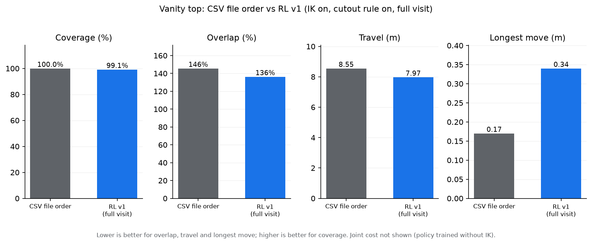
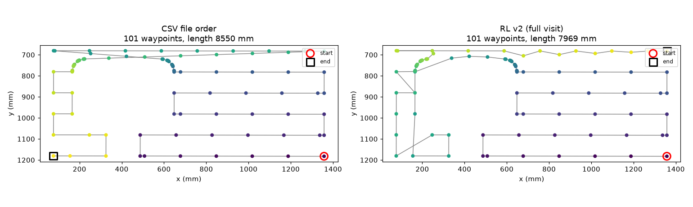
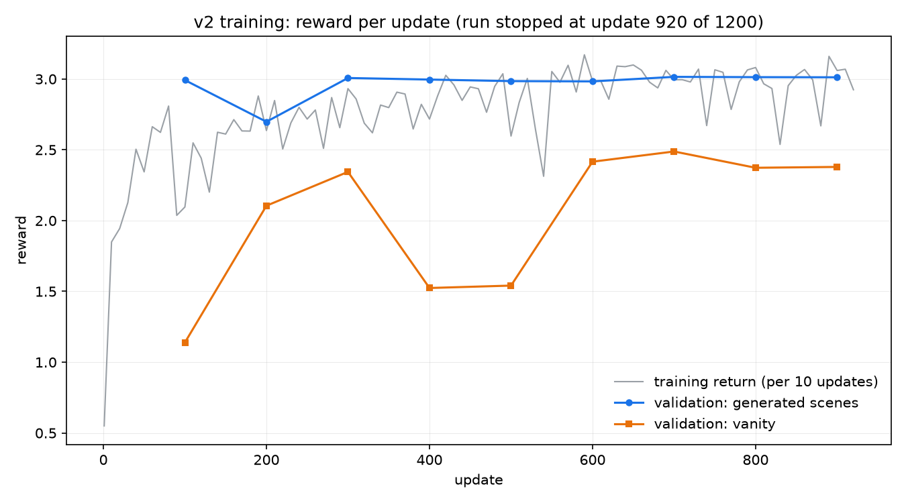

# curl: Coverage Path Planning with Reinforcement Learning

A reinforcement-learning policy orders the surface waypoints for a UR10e arm so that a cleaning or inspection tool covers a flat surface (here, a bathroom vanity top). The repo compares one thing: the coverage, overlap and travel of the **CSV's own waypoint order** against the **RL policy's path**, on the same scene with the same scorer.

**Status:** the current model (v1) visits all 101 vanity waypoints with no off-surface travel. Against the CSV's own order it travels less (7.97 m against 8.55 m) and overlaps less (136% against 146%), but it covers less (99.15% against 100%) and its longest move is longer (0.34 m against 0.17 m). It is not converged, and the vanity was used to pick its checkpoint. See [Results](#4-results) and [`results/REPORT.md`](results/REPORT.md) for the numbers and caveats.

## Contents

1. [Why RL for coverage](#1-why-rl-for-coverage)
2. [Training the RL agent](#2-training-the-rl-agent)
3. [Results](#3-results)
4. [Quick start](#4-quick-start)
5. [Repository layout](#5-repository-layout)
6. [Assumptions and limitations](#6-assumptions-and-limitations)

---

## 1. Why RL for coverage

The CSV order is the reference. The planning problem has terms that a fixed order does not optimise:

- **Coverage, not distance.** The objective is to cover the target, with overlap and skipped areas both costing something. Travel is only one term.
- **Feasibility.** Moves must stay on the surface, avoid the sink cutout, and use poses the UR10e can reach and that keep its links clear of the tabletop. These are hard to express in a fixed order.
- **Learnable structure.** Good orders share patterns, such as finishing a row before starting the next and keeping overlap low at row ends. A policy can learn these from many scenes.
- **Fast decisions.** Once trained, a policy gives a path in one forward pass per step.
- **Variable size.** A pointer network takes any number of waypoints, so the same model works for different bathrooms.

The RL path has to beat the CSV order on coverage, overlap and feasibility. The results report whatever the numbers show.

## 2. Training the RL agent

### 2.1 Model

A **pointer network** over waypoints (`src/curl/models/pointer.py`):

- Each waypoint gets 12 input features: normalised position, normal, visited flag, current-waypoint flag, reachability, share of nearby stroke cells still uncovered, offset from the current waypoint, and global coverage.
- A Transformer encoder (3 layers, width 128, 8 heads) turns these into one embedding per waypoint.
- A pointer decoder combines the graph mean with the current waypoint's embedding, scores every unvisited, reachable waypoint, and softmaxes over them. Unavailable waypoints are masked out.

### 2.2 Algorithm

**REINFORCE with a POMO-style shared baseline** (`src/curl/training/trainer.py`).

- For each training scene, K rollouts (default 8) run in lockstep. Each starts with a free first pick, so they explore different starting points.
- The baseline for each rollout is the mean return of the K rollouts on that scene. Advantages are the return minus this mean, so no separate value network is needed.
- The loss is the policy-gradient term plus an entropy bonus that encourages exploration. The bonus decays linearly to zero over training.
- Adam optimiser, cosine learning-rate decay, gradient-norm clipping at 1.0.
- Every 100 updates the greedy policy is scored on 10 generated scenes **and on the vanity top**. The checkpoint is chosen by `0.5 × generated reward + 0.5 × vanity reward`, so the vanity is used for selection and is not an independent test.

We did not use PPO or a learned value function. REINFORCE with a shared baseline is simple and fits well with rolling out many similar scenes at once.

### 2.3 Environment and reward

The environment (`src/curl/env/sweep_env.py`) is grid-based. Each waypoint stamps a tool disk on a 1 cm grid, and each move sweeps the tool along the straight segment to the next waypoint. The episode ends when the coverage target is reached or when every reachable waypoint has been visited.

Reward per step:

    w_cov × new coverage − w_overlap × overlap − w_jump × travel (m)
    − w_off × off-surface travel (m) − w_turn × turn − w_joint × joint motion (rad)

Defaults: `w_cov = 4.0`, `w_overlap = 0.5`, `w_jump = 0.1`, `w_off = 1.0`, `w_turn = 0.05`, `w_joint = 0.05`.

**Stuck penalty.** If unvisited waypoints remain but no legal move exists, the episode ends and the reward takes a penalty of `w_stuck × unvisited share`, with `w_stuck = 2.0`.

**Cutout rule.** Any move whose straight line leaves the surface is masked out, both in training and at plan time. The pairwise matrix is computed once per scene and shared by that scene's rollouts. This is a feasibility rule, so it applies to any trained weights.

### 2.4 Training data

Scenes come from `src/curl/data/generate.py`: a rectangular top of random size (0.5–1.5 m by 0.35–0.6 m), row spacing 8–11 cm, waypoint step 10–22 cm, up to two rectangular cutouts (70% of scenes) and an optional corner notch (30%). Waypoints are shuffled, so the policy gets no order hint. Training uses seed 0 and validation uses a separate seed.

### 2.5 Training command

```bash
. .venv/bin/activate
curl-train --updates 1200 --scenes 12 --rollouts 8
```

The log prints training return every 10 updates and validation every 100. The checkpoint is written to `results/pointer_policy_v1.pt`, **which retraining overwrites**. Pass `--ckpt` to write to another file.

On an RTX 5070, the v1 run took about 5.6 seconds per update, so 1,200 updates take roughly 1 h 50 min.

### 2.6 Parameters to tune

These are the parameters that most affect whether the model learns, and how fast. The optimisation, validation and seed settings are keys under `training:` in `configs/default.yaml`. Reward weights, model size and scene ranges are set in code, because the checkpoint and the scorer depend on them.

| Group | Parameter (default) | Why it matters |
|---|---|---|
| **Reward** | `w_cov` (4.0), `w_overlap` (0.5) | The coverage-versus-overlap trade-off. Too little coverage weight and the policy skips strokes. |
| | `w_jump` (0.1), `w_off` (1.0) | Travel and off-surface penalties. Too little and the policy takes long moves. |
| | `w_stuck` (2.0) | Penalty for a dead end. Too little and the policy learns to strand waypoints. |
| | `w_joint`, `w_turn` (0.05) | Motion smoothness. Only matter once the joint model is used in training. |
| | `coverage_target` (0.98 planning, 1.01 full visit) | When an episode ends. A target below 1 lets the policy stop early. |
| **Optimisation** | `--lr` (3e-4), `--lr-min` (3e-5) | Learning rate and its cosine floor. Too high and the policy oscillates. |
| | `--updates` (1200) | Training length. The v1 run was stopped at 920, before the schedule finished. |
| | `--scenes` (12), `--rollouts` (8) | Batch size. More scenes give less noisy gradients; more rollouts give a better baseline. |
| | `--ent` (0.01) | Exploration. Too high and the policy stays random; too low and it converges early. |
| | `--seed` | Runs with different seeds vary a lot, so try several. |
| **Validation** | `--val-every` (100), `--val-scenes` (10) | How often and how thoroughly the best checkpoint is picked. |
| | `--ckpt` | Where the best checkpoint is written. The default overwrites v1. |
| **Model** | width 128, 3 layers, 8 heads | Capacity. Usually matters less than the inputs and reward. |
| **Inputs** | the 12 features | The uncovered-cell feature was the biggest change between versions. Adding information the policy needs to see is worth more than adding capacity. |
| **Scenes** | size, row gap, step, cutout probability (0.7), corner-notch probability (0.3) | Variety. Regular grids are easy, so RL gets little to learn from them. |
| **Geometry** | tool radius (0.05 m), grid cell (0.01 m), local radius (0.10 m) | What counts as covered and how fine the coverage check is. Smaller cells are slower. |

**Practical tips for efficient training**
- Keep the cutout rule in training, so the policy learns only moves the planner allows. Without it the policy dead-ended on the sink.
- Cache the pairwise segment check per scene. It is the slowest part of building an environment (v1 does this).
- Watch validation coverage and overlap, not only the reward. The reward can stay flat while coverage swings, as it did on the vanity.
- Check the vanity against a checkpoint it did not help pick, or use a held-out set. The vanity is currently part of selection.
- Run several seeds and compare the spread, not a single run.

## 3. Results

### 3.1 Vanity top: CSV order against RL v1

The vanity top has 101 waypoints, all reachable from the assumed base pose. Both paths use the same scorer: IK on, cutout rule on, full-visit episodes, default reward weights. Source: `results/vanity_rl_v1_metrics.csv`.

The metrics do not include joint cost in training: the policy is trained without IK terms, so the joint-motion column is reported but not optimised for.

| Path | Coverage | Overlap | Steps | Travel | Longest move | Off-surface | Reward |
|---|---|---|---|---|---|---|---|
| **CSV file order** | **100.00%** | 145.6% | 101 | 8.55 m | **0.17 m** | 0.00 m | −2.74 |
| **RL v1 (full visit)** | 99.15% | **136.2%** | 101 | **7.97 m** | 0.34 m | 0.00 m | **−2.50** |





**Reading the table.**
- v1 covers the same rows with less travel and less overlap than the CSV order.
- It does not reach full coverage: 0.85% of the target is left uncovered.
- Its longest move is about twice the CSV's, a diagonal in the lower-left area.

### 3.2 Training curves



- **Generated scenes:** validation reward reaches about +3.0 by update 300 and stays there.
- **Vanity:** validation reward swings with the policy. Coverage was 81.5% at update 100, 98.8% at 300, 82.7% at 500, and 99.2% at 700 (the saved checkpoint). The policy got stuck at updates 100, 400 and 500.
- **Convergence:** not converged. Entropy had fallen to about 0.002, and the learning rate was still 6.5e-5 when the run stopped at update 920.

Full table in [`results/REPORT.md`](results/REPORT.md) §5.

### 3.3 Figures

Figures are in `results/`:
- `vanity_compare_v1.png`: CSV order against RL v1, metric by metric.
- `vanity_paths_compare_v1.png`: the two coverage paths side by side.
- `vanity_rl_v1_coverage_path.png`: the RL v1 path alone.
- `vanity_file_order_as_csv.png`: the CSV order path alone.
- `train_curve_v1.png`: training and validation reward against update number.

### 3.4 Conclusion

v1 is the first RL model in this repo that visits every vanity waypoint without dead ends or off-surface travel. Against the CSV's own order it travels less and overlaps less, but it covers less (99.15% against 100%) and makes a longer largest move (0.34 m against 0.17 m). The CSV's own order is still the stronger reference on coverage.

Two caveats limit how far these results go. The vanity was used to pick the checkpoint, and the policy is not converged. A held-out check, several seeds and a finished training schedule are the next steps. See [`results/REPORT.md`](results/REPORT.md) for the full analysis.

## 4. Quick start

```bash
# set up the environment (installs the `curl` package in editable mode)
python3 -m venv .venv
. .venv/bin/activate
pip install -e ".[dev]"

# tests
python -m pytest -q

# compare the CSV order with the RL v1 path on the vanity top
curl-plan --visit-all --out results/vanity_rl_v1

# train from scratch (overwrites results/pointer_policy_v1.pt)
curl-train --updates 1200 --scenes 12 --rollouts 8
```

Each command is also available as `python -m curl.cli.<name>` (for example `python -m curl.cli.train`).

Settings come from `configs/default.yaml` (paths, environment geometry, IK, training). Pass `--config <file>` to use another file, for example for a quick experiment. Command-line flags such as `--updates`, `--base` or `--checkpoint` override the YAML for one run. Unknown or missing keys, and numbers written as text, stop the run with an error naming the key. Each run also records its resolved settings: training writes `<checkpoint>.yaml` next to the checkpoint, and `curl-plan` writes `<out>_config.yaml`. Either file can be passed back with `--config` to reproduce the run. The `run:` switches in a saved file (`visit_all`, `no_ik`, `allow_off_surface`) apply on reload; a flag can turn one on but not off.

`curl-plan` accepts another waypoint CSV with `--csv`. Units are millimetres, with a unit normal per row. Output: the RL path (`*_path.csv`), a figure, and a metrics table comparing it with the CSV order.

## 5. Repository layout

Settings live in `configs/default.yaml`. The package lives in `src/curl/`:

```
configs/
  default.yaml         paths, environment geometry, IK base pose and restarts, training
src/curl/
  config.py            loads and validates the YAML settings
  data/
    vanity.py          load the vanity CSV (mm to m, drop duplicates)
    generate.py        procedural tabletop scenes for training and validation
  env/
    sweep_env.py       grid-based sweep-coverage environment, stuck penalty
    scoring.py         evaluate_order() and summarize(): the one scorer used everywhere
    factory.py         builds envs with the project settings (full-visit, cutout rule)
  kinematics/
    ur10e.py           UR10e forward kinematics, numerical IK, link-clearance check
  models/
    pointer.py         pointer-network policy and node features
  training/
    trainer.py         REINFORCE with POMO-style baseline, checkpoint selection
    rollout.py         lockstep policy rollouts
    validation.py      greedy validation on generated scenes and the vanity
    checkpoint.py      loading saved policies
  evaluation/
    scene.py           scene env setup with IK reachability
    plotting.py        path figures
  cli/
    train.py           curl-train
    plan.py            curl-plan: CSV order vs RL path
tests/                 pytest tests
input/                 vanity waypoint CSV
results/               RL path, metrics, figures, logs, REPORT.md, policy checkpoint (pointer_policy_v1.pt)
```

## 6. Assumptions and limitations

- **Base pose is assumed** at (0.72, 0.40, 0.40) m. At floor height every waypoint fails the clearance check. The real mounting height is unknown.
- **Tool radius of 50 mm** is derived from the 100 mm row spacing in the data.
- **Inverse kinematics is numerical**, with random restarts, not the analytic solver.
- **Collision is simplified:** elbow and wrist heights only. No self-collision or full-mesh check.
- **The cutout rule checks straight moves between waypoints.** The arm's joint path still needs its own IK and collision check before hardware use.
- **Training does not include IK or reachability**, so the policy learns the cutout rule and the stuck penalty, but not the arm's joint limits.
- **The vanity is used for checkpoint selection**, so its numbers are optimistic.
- **Single seed, stopped early.** The v1 run stopped at update 920 of 1,200 and is not converged.
- **Overlap is summed over moves**, so values above 100% are expected.
- **Path only.** The planner gives a visit order. Joint trajectories, speed and timing are not generated.
