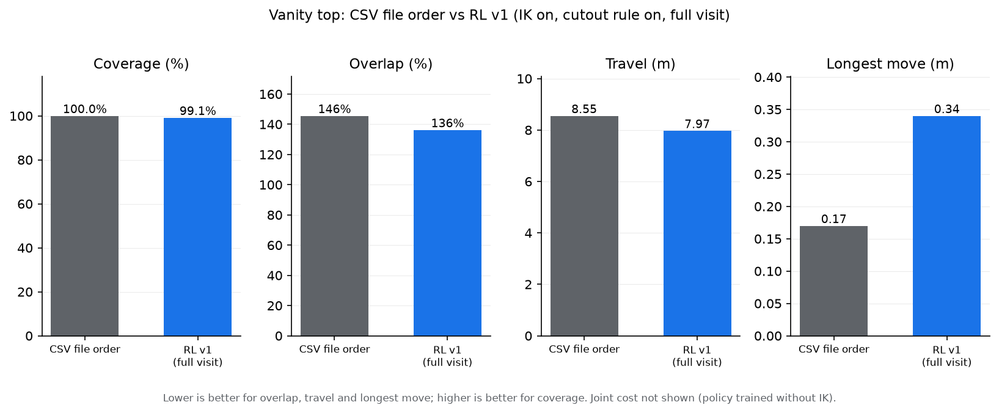
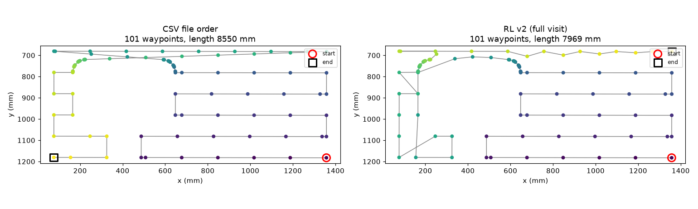
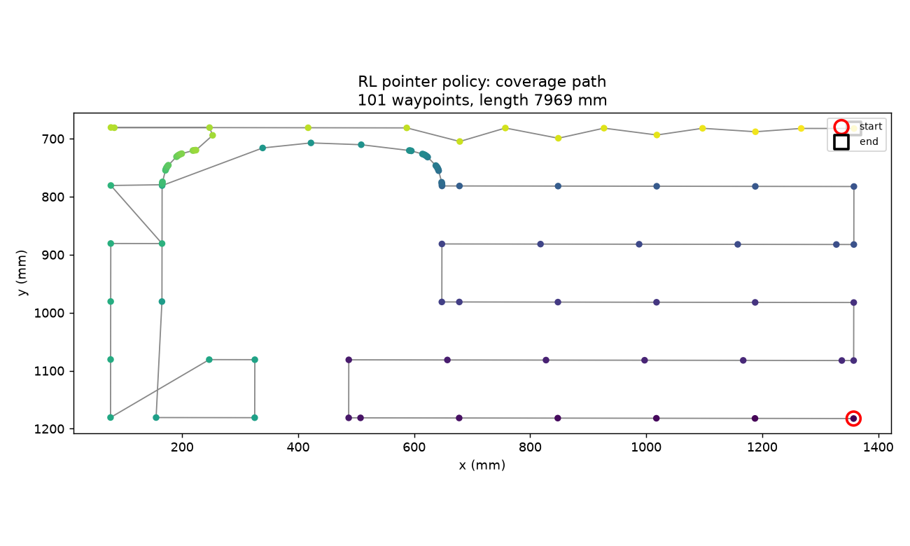
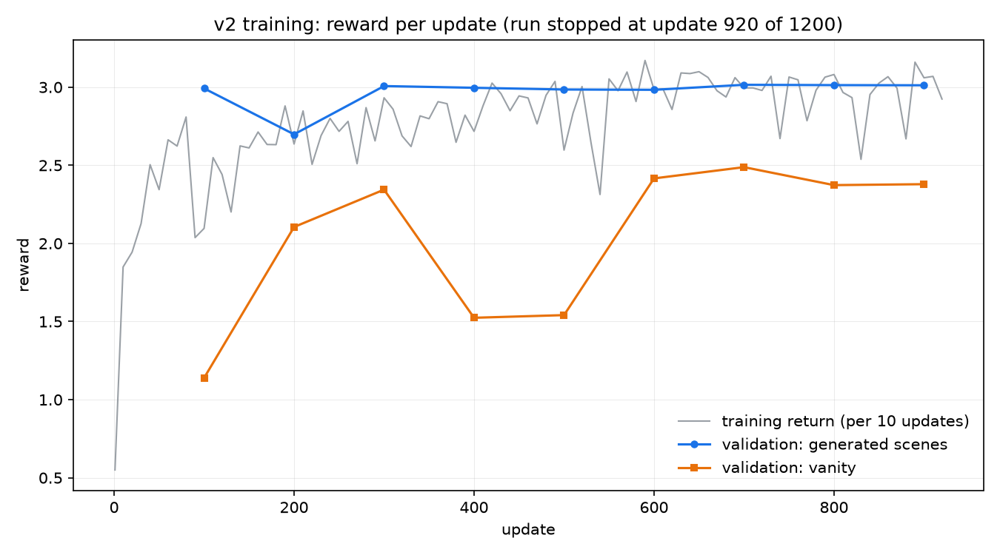

# RL Coverage Path Planner: Results Report

## Executive summary

- **v1 is the current model.** It was trained with the sink-cutout rule in the training loop, a penalty for getting stuck, and the vanity top as one validation case. It visits all 101 vanity waypoints with no off-surface travel.
- **Against the CSV's own order, v1 is mixed.** It travels less (7.97 m against 8.55 m) and overlaps less (136% against 146%). It covers less (99.15% against 100%) and has a longer largest move (0.34 m against 0.17 m).
- **v1 is not converged.** The generated-scene reward levelled off at about +3.0 from update 300. The vanity result kept swinging between 81% and 99% coverage, and the run was stopped at update 920 of 1,200.
- **The vanity was used to pick the checkpoint.** The saved checkpoint (update 700) was chosen partly on its vanity score, so the vanity numbers are not an independent test.

## 1. Problem

A UR10e arm on a mobile base must visit surface waypoints so that a 50 mm tool covers the target surface. The planner chooses the visit order.

The test surface is the vanity top in `input/Vanity_Large_Top_Points.csv`:

- 160 raw rows, collapsing to **101 unique waypoints** after removing consecutive duplicates.
- Coordinates in millimetres, normals pointing up (+z).
- The file order is a sweep of 100 mm rows with a notch on the left, totalling 8,550 mm.
- A sink cutout sits in the middle. Moves across it leave the surface and are not allowed.

## 2. Method

**Environment (`src/curl/env/sweep_env.py`).** The surface is a 1 cm grid. Each waypoint stamps a 50 mm disk, and each move sweeps the tool along the straight segment to the next waypoint. The target is the union of waypoint disks and the stroke segments in the source data.

Reward per step:

    4 × new coverage − 0.5 × overlap − 0.1 × travel (m) − 1.0 × off-surface travel (m) − 0.05 × turn − 0.05 × joint motion (rad)

When the policy reaches a dead end (unvisited waypoints remain, but no legal move exists), the episode ends with a penalty of `w_stuck × unvisited share`, with `w_stuck = 2.0`.

**Cutout rule.** Moves whose straight line leaves the surface are masked out, both at training time and at plan time. The pairwise matrix is computed once per scene and shared by the rollouts for that scene.

**Kinematics (`src/curl/kinematics/ur10e.py`).** UR10e forward kinematics use the published DH parameters. Inverse kinematics is numerical, with random restarts. The tool points down. A simple clearance check requires the elbow and wrist joints to stay above the tabletop. The base is assumed at (0.72, 0.40, 0.40) m. At floor height the clearance check rejected every waypoint.

**Policy (`src/curl/models/pointer.py`, `src/curl/training/trainer.py`).** A Transformer encoder over waypoints feeds a pointer decoder. Each waypoint has 12 input features. Training uses REINFORCE with a POMO-style shared baseline, cosine learning-rate decay, a decaying entropy bonus, and gradient clipping. Every 100 updates the greedy policy is scored on 10 generated scenes and on the vanity. The checkpoint is chosen by `0.5 × generated reward + 0.5 × vanity reward`.

## 3. Models

| Model | What it is | Status |
|---|---|---|
| **v1 (current)** | Trained with the cutout rule, stuck penalty and vanity validation. Best checkpoint at update 700 of a run stopped at 920 of 1,200. | `results/pointer_policy_v1.pt` |
| Earlier full-visit model | Trained without the cutout rule. Reached 80.95% on the vanity, stopping at 80 of 101 waypoints (dead ends). | Deprecated and removed from `results/`. |
| Earlier cutout-safe model (98% stop) | Planned with the cutout rule, but its episodes stopped at 98% coverage. Reached 98.76% in 39 moves. | Deprecated and removed. |
| Original model | First run: 150 updates, 8 input features, original reward weights. | Deprecated and removed. |

## 4. Results on the vanity top

### 4.1 v1 against the CSV order

All numbers use the same scorer: IK on, cutout rule on, full-visit episodes, default reward weights. Source: `results/vanity_rl_v1_metrics.csv`.

| Path | Coverage | Overlap | Steps | Travel | Longest move | Off-surface | Reward |
|---|---|---|---|---|---|---|---|
| **CSV file order** | **100.00%** | 145.6% | 101 | 8.55 m | **0.17 m** | 0.00 m | −2.74 |
| **RL v1 (full visit)** | 99.15% | **136.2%** | 101 | **7.97 m** | 0.34 m | 0.00 m | **−2.50** |

The policy was trained without IK terms, so the joint-cost column is not what it was optimised for.



*Figure: CSV file order against RL v1 on the same scorer. Lower is better for overlap, travel and longest move. Higher is better for coverage. Joint cost is not shown, because the policy was trained without IK.*



*Figure: the coverage paths. Left: the CSV file order, a row sweep with a 0.17 m move at each row turn. Right: RL v1, which reorders the left-side strokes and the top edge. Its longest move (0.34 m) is a diagonal in the lower-left area.*



**Reading the table.**
- v1 covers the same rows with less travel and less overlap than the CSV order.
- It does not reach full coverage: 0.85% of the target is left uncovered.
- Its longest move is about twice the CSV's.

## 5. Training

Source: `results/train_log_v1.txt`. Validation runs every 100 updates on 10 generated scenes and on the vanity.

| Update | Generated coverage | Generated reward | Vanity coverage | Vanity steps | Vanity stuck | Vanity reward | Score |
|---|---|---|---|---|---|---|---|
| 100 | 99.81% | +2.992 | 81.52% | 42 | yes | +1.139 | +2.065 |
| 200 | 93.46% | +2.698 | 96.56% | 101 | no | +2.105 | +2.402 |
| 300 | 99.83% | +3.007 | 98.79% | 101 | no | +2.344 | +2.676 |
| 400 | 99.07% | +2.996 | 81.95% | 62 | yes | +1.524 | +2.260 |
| 500 | 99.47% | +2.985 | 82.66% | 66 | yes | +1.541 | +2.263 |
| 600 | 98.38% | +2.983 | 97.97% | 101 | no | +2.416 | +2.700 |
| **700 (saved)** | 99.86% | +3.015 | 99.15% | 101 | no | +2.488 | **+2.752** |
| 800 | 99.61% | +3.013 | 99.07% | 101 | no | +2.373 | +2.693 |
| 900 | 99.58% | +3.012 | 99.28% | 101 | no | +2.379 | +2.695 |



*Figure: training return (grey, every 10 updates), validation reward on generated scenes (blue) and on the vanity (orange), against update number. The generated-scene reward plateaus at about +3.0 from update 300. The vanity reward is unstable; its dips at updates 400 and 500 are where the policy got stuck.*

**Convergence.** The generated-scene reward has plateaued. The vanity result has not settled: it swung between 81% and 99% coverage, and the policy got stuck at updates 100, 400 and 500. Entropy had fallen to about 0.002, so the policy was nearly deterministic. The learning rate was still 6.5e-5 at update 920, above its floor of 3e-5. The run was stopped before the schedule finished, so v1 should not be treated as converged.

## 6. Limitations

- **The vanity was used to pick the checkpoint.** The best checkpoint was chosen partly on its vanity score, so the vanity numbers are optimistic.
- **Single seed, stopped early.** One run with seed 0, stopped at update 920 of 1,200.
- **Vanity results are unstable.** Coverage on the vanity swung between 81% and 99% across validations.
- **Coverage below the CSV.** v1 leaves about 0.85% of the target uncovered, while the CSV order covers all of it.
- **Longer longest move.** The longest move (0.34 m) is about twice the CSV's (0.17 m).
- **Training ignores IK and reachability.** The policy is trained without IK, so the joint-cost column is not what it was optimised for.
- **Base pose is assumed** at (0.72, 0.40, 0.40) m. The real mounting height is unknown.
- **Simplified collision.** Only elbow and wrist heights are checked against the tabletop.
- **Overlap is summed over moves**, so values above 100% are expected.

## 7. Next steps

1. **Held-out check.** Run v1 on a fresh set of generated scenes, using seeds the checkpoint selection never touched, and compare coverage, overlap and travel with the CSV order on the same scenes.
2. **Several seeds.** Report the spread across seeds, not one run.
3. **Finish the schedule.** Run to 1,200 updates, or justify stopping early with a convergence check.
4. **IK in training**, so the policy sees the same reachability constraints as the benchmark.

## 8. Reproducing these results

```bash
cd <repo root>
. .venv/bin/activate
python -m pytest -q
curl-plan --visit-all --out results/vanity_rl_v1      # v1 path vs CSV order, full visit, cutout rule on
curl-train --updates 1200 --scenes 12 --rollouts 8    # retrain; OVERWRITES results/pointer_policy_v1.pt
```

The settings these commands use are in `configs/default.yaml`. Retraining overwrites `results/pointer_policy_v1.pt`. To keep the current model, pass `--ckpt` to write somewhere else.
